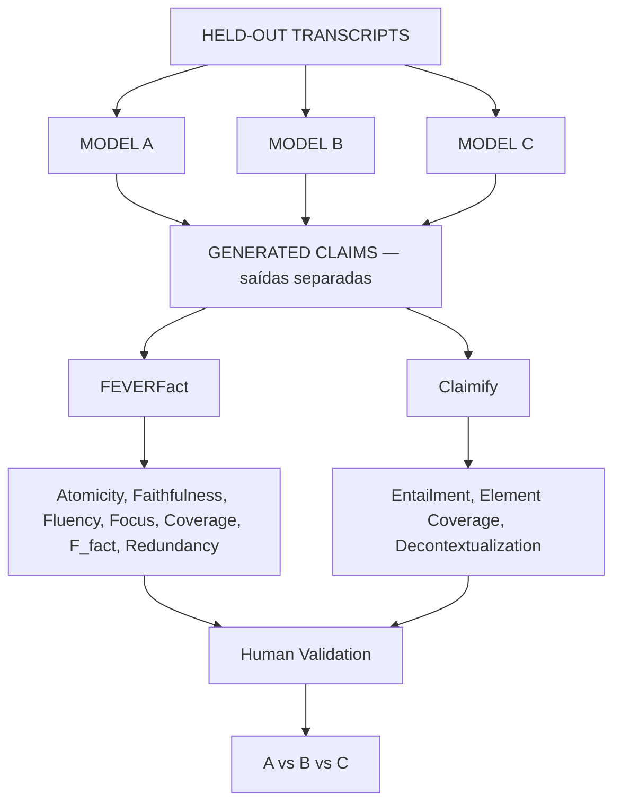

# Metodologia do Benchmark de Claim Extraction — Modelos A, B e C

## 1. Objetivo

Esta etapa do projeto tem como objetivo comparar **três modelos open-model** para a tarefa de **Claim Extraction** sobre transcrições de vídeos relacionados a medicamentos GLP-1, como semaglutida/Ozempic.

O benchmark avalia exclusivamente a **qualidade intrínseca dos claims extraídos**. Nesta fase, não serão utilizadas métricas da etapa posterior de classificação de desinformação ou verificação de veracidade.

A pergunta principal é:

> **Qual dos Modelos A, B e C produz o conjunto de claims de maior qualidade intrínseca quando aplicado ao mesmo conjunto de transcrições e à mesma metodologia de Claim Extraction?**

A comparação utiliza **FEVERFact + Claimify**: mesmos transcripts held-out, três claim extractors e duas avaliações complementares, seguidas de validação humana e comparação A/B/C.

---

## 2. Escopo: Claim Extraction

A etapa de Claim Extraction responde:

> **O que exatamente está sendo afirmado no vídeo?**

Ela é separada das etapas futuras de:

- Claim Classification;
- Claim Verification;
- classificação de desinformação;
- atribuição de veracidade;
- harmfulness;
- evidence grounding externo.

Portanto, um claim pode ser **fiel ao transcript** mesmo que posteriormente seja classificado como falso, enganoso ou sem evidência.

---

## 3. Pipeline lógica comum

Todos os modelos deverão satisfazer a mesma especificação funcional: selecionar spans, decompor proposições, normalizar e decontextualizar. Isso não exige quatro chamadas independentes ao LLM; a extração pode ser end-to-end. O protocolo de entrada e avaliação é comum, e diferenças internas devem ser documentadas.

```text
YouTube Video
      ↓
Transcript
      ↓
Claim Span Identification
      ↓
Atomic Claim Decomposition
      ↓
Claim Normalization
      ↓
Decontextualization
      ↓
CLAIM DATASET
```

### 3.1 Claim Span Identification

Identifica no transcript os trechos que contêm afirmações potencialmente verificáveis, removendo conteúdo sem valor factual para o Claim Dataset.

Exemplos de conteúdo que pode ser descartado:

- saudações;
- chamadas para inscrição no canal;
- repetições sem nova informação;
- transições discursivas;
- conteúdo puramente conversacional.

Base científica principal: Sundriyal et al. (2022) e Mittal et al. (2023).

### 3.2 Atomic Claim Decomposition

Divide uma sentença ou trecho contendo múltiplas proposições em claims independentes.

Exemplo:

```text
"Ozempic reduz o apetite e não apresenta efeitos adversos importantes."
```

torna-se:

```text
C001 — Ozempic reduz o apetite.
C002 — Ozempic não apresenta efeitos adversos importantes.
```

Base científica principal: Min et al. (2023), FActScore.

### 3.3 Claim Normalization

Reduz ruído linguístico e transforma linguagem falada/coloquial em uma formulação factual mais clara, sem alterar o significado original.

Exemplo:

```text
"tipo assim, o Ozempic meio que corta muito a fome"
```

pode ser normalizado para:

```text
"Ozempic reduz a sensação de fome."
```

Base científica principal: Sundriyal, Chakraborty & Nakov (2023), ClaimNorm.

### 3.4 Decontextualization

Transforma o claim em uma afirmação que possa ser compreendida isoladamente.

Exemplo:

```text
Contexto:
"Agora vamos falar sobre semaglutida."

Trecho:
"Ela reduz o apetite."
```

Saída:

```text
"Semaglutida reduz o apetite."
```

Base científica principal: Choi et al. (2021) e Deng et al. (2024).

---

## 4. Modelos do benchmark

Todos os modelos devem possuir pesos publicamente acessíveis e licença compatível com uso e reprodução acadêmica.

### 4.1 Modelo A — Scientific Baseline

**Modelo:** `Mistral-7B-Instruct-v0.2`

**Papel:** baseline científico.

**Justificativa:** Ullrich et al. (2025) utilizaram Mistral-7B-Instruct-v0.2 com adaptação QLoRA no FEVERFact. Entre os modelos avaliados no trabalho, `qlora-mistral-instruct` apresentou o maior `F_fact` automático (0,61) e humano (0,64).

O Modelo A deve ser reproduzido o mais próximo possível da configuração descrita no FEVERFact, documentando:

- checkpoint base;
- versão do tokenizer;
- treinamento/adaptação;
- hiperparâmetros;
- prompt;
- configuração de inferência;
- seed;
- hardware;
- versão das bibliotecas.

**Objetivo experimental:**

> Estabelecer uma referência baseada diretamente em evidência científica publicada para Claim Extraction.

---

## 4.2 Modelo B — Community Specialized Claim Extractor

**Modelo principal:** `principled-intelligence/claim-extractor-4B-q-2605`

**Backbone:** Qwen3.5-4B.

**Licença:** Apache 2.0.

**Papel:** modelo open-model da comunidade especificamente especializado em Claim Extraction.

O model card descreve o modelo como um extractor de afirmações:

- atômicas;
- autocontidas;
- decontextualizadas;
- estruturadas;
- destinadas a pipelines de fact-checking e auditoria.

**Objetivo experimental:**

> Avaliar se um modelo aberto especializado pela comunidade em Claim Extraction alcança ou supera o baseline científico.

### Modelo comunitário complementar

O modelo:

`Luimas/claim-extractor-detective-qwen3b`

pode ser utilizado como **experimento complementar**, mas não como um dos três modelos principais, porque seu model card declara suporte apenas a inglês.

Características relevantes:

- Qwen2.5-3B;
- QLoRA;
- distillation a partir de Qwen2.5-14B;
- claims atômicos;
- `evidence_span` verbatim;
- JSON estruturado;
- Apache 2.0.

Ele pode ser avaliado separadamente em transcripts originalmente em inglês ou em um estudo específico de generalização cross-lingual.

---

## 4.3 Modelo C — GLP-1 Domain-Adapted Claim Extractor

**Base preferencial:** mesma família/backbone do Modelo B.

Estratégia preferencial:

```text
Community Claim Extractor
Qwen3.5-4B
       ↓
SFT / QLoRA
       ↓
GLP-1 Claim Extraction Dataset
       ↓
Modelo C
```

O Modelo C será adaptado com exemplos humanos do domínio:

- semaglutida;
- tirzepatida;
- agonistas de GLP-1;
- medicamentos para perda de peso;
- alegações médicas em vídeos;
- linguagem falada e social media;
- termos médicos e nomes comerciais.

A opção preferencial é iniciar a adaptação a partir do checkpoint do Modelo B, permitindo que a comparação B → C represente diretamente o efeito da **adaptação ao domínio GLP-1**.

O treinamento do C utiliza o split `train`; `development` é reservado à seleção de checkpoint, prompts e hiperparâmetros.

O `test set` não poderá ser utilizado no treinamento, seleção de checkpoint ou ajuste de hiperparâmetros.

**Objetivo experimental:**

> Verificar se a adaptação específica ao domínio GLP-1 melhora a qualidade intrínseca dos claims em comparação com um Claim Extractor comunitário genérico.

---

# 5. Dataset experimental

O corpus será dividido antes do treinamento do Modelo C:

```text
GOLD DATASET
     ↓
┌───────────┬───────────┬───────────┐
│           │           │           │
Train       Dev         Test
│           │           │
Modelo C    tuning      A/B/C
training                benchmark
```

Separar vídeos inteiros entre os splits, antes do chunking. Agrupar duplicatas e versões do mesmo vídeo no mesmo split; documentar eventual separação por canal. A e B permanecem congelados.

O **held-out test set** será processado pelos três modelos:

```text
                  HELD-OUT TEST SET
                         │
          ┌──────────────┼──────────────┐
          ↓              ↓              ↓
       MODEL A         MODEL B        MODEL C
          │              │              │
          └──────────────┼──────────────┘
                         ↓
               INTRINSIC CLAIM QUALITY
```

---

# 6. Gold Claims

Para medir adequadamente Focus, Coverage e `F_fact`, cada transcript do benchmark deverá possuir um conjunto de **gold claims** produzido ou validado por anotadores humanos.

Estrutura mínima recomendada:

```text
transcript_id
claim_id
source_text
claim
```

Opcionalmente:

```text
start_timestamp
end_timestamp
source_span
annotator_id
```

O gold dataset representa:

> **quais claims deveriam ser extraídos daquele transcript.**

Ele não deve conter ainda o julgamento final de veracidade como requisito para o benchmark de Claim Extraction.

Para Element-Level Coverage, manter também um inventário comum de elementos da fonte, verificáveis e não verificáveis, ancorados por spans. Gold claims e elementos são referências diferentes: os primeiros medem conteúdo esperado; os segundos permitem medir omissões e inclusão explícita de conteúdo não verificável.

---

# 7. Protocolo de inferência

A comparação A/B/C deve controlar o máximo possível de variáveis externas.

Todos os modelos recebem:

- os mesmos transcripts;
- os mesmos splits;
- o mesmo procedimento de chunking;
- o mesmo Context Window;
- as mesmas instruções funcionais;
- o mesmo schema de saída;
- o mesmo limite máximo de output;
- a mesma política de tratamento de erros;
- parâmetros determinísticos sempre que suportados.

Preferencialmente:

```text
temperature = 0
```

e seed fixa quando o framework permitir.

Todos os outputs finais e seus spans de origem devem ser persistidos. Quando houver etapas explícitas, também serão armazenados os outputs intermediários:

```text
Transcript
   ↓
Claim Span
   ↓
Atomic Claims
   ↓
Normalized Claims
   ↓
Decontextualized Claims
```

Isso permite auditoria e, quando aplicável, análise de erro por etapa. Não se devem inventar resultados intermediários para modelos end-to-end. Os avaliadores serão fixos entre A/B/C, sem utilizar cada extractor para julgar a própria saída.

---

# 8. Framework de avaliação

A avaliação possui dois ramos aplicados separadamente às saídas de cada modelo:

- **FEVERFact:** Atomicity, Faithfulness, Fluency, Focus, Coverage, `F_fact` e Redundancy.
- **Claimify:** Entailment, Element-Level Coverage e Decontextualization.

Os resultados são confrontados com validação humana antes da comparação final. `F_fact` permanece a métrica agregada primária. Não será criada uma média única dos dois frameworks.

As subseções 8.1 e 8.2 descrevem o ramo FEVERFact; a 8.3 define o ramo Claimify e sua adaptação ao projeto. Aqui, Claimify designa o **framework de avaliação**, não um quarto extractor.

---

## 8.1 Métricas por claim — reference-free

### Atomicity

Pergunta:

> O claim contém apenas uma proposição factual principal?

Exemplo:

```text
"Ozempic reduz o apetite."
```

é mais atômico que:

```text
"Ozempic reduz o apetite e provoca perda de peso."
```

**Direção:** maior = melhor.

No FEVERFact, a implementação automática reduz Atomicity a Relation Extraction usando **REBEL Large**.

---

### Faithfulness

Pergunta:

> O claim contém apenas informações consistentes com o transcript original?

Essa métrica não mede verdade científica.

Exemplo:

```text
Transcript:
"Ozempic não causa nenhum efeito adverso."

Claim:
"Ozempic não causa nenhum efeito adverso."
```

O claim pode ter alta Faithfulness mesmo que posteriormente seja considerado falso.

**Direção:** maior = melhor.

No FEVERFact, Faithfulness é estimada com **AlignScore** entre fonte e claim.

---

### Decontextualization — FEVERFact, diagnóstico opcional

Pergunta:

> O claim pode ser interpretado corretamente sem consultar o restante do transcript?

Exemplo inadequado:

```text
"Ele reduz o apetite."
```

Exemplo decontextualizado:

```text
"Ozempic reduz o apetite."
```

**Direção:** maior = melhor.

No FEVERFact, essa propriedade é avaliada utilizando o modelo T5 de decontextualização derivado de Choi et al. (2021). Neste benchmark, o eixo principal de Decontextualization fica no ramo Claimify (§8.3). O score T5, se calculado, será reportado separadamente como diagnóstico; os dois não são intercambiáveis.

---

### Fluency

Pergunta:

> O claim é gramaticalmente correto, claro e inteligível?

**Direção:** maior = melhor.

No FEVERFact, a avaliação automática utiliza **CoEdIT + Scribendi**.

---

# 8.2 Métricas do conjunto de claims — reference-based

Essas métricas dependem dos gold claims humanos.

Considere:

```text
C = claims produzidos pelo modelo
G = gold claims humanos
```

---

### Focus

Pergunta:

> Quanto da informação produzida pelo modelo corresponde à informação relevante presente no gold dataset?

É conceitualmente semelhante a **Precision**.

Um modelo que produz muitos claims irrelevantes tende a apresentar menor Focus.

**Direção:** maior = melhor.

No FEVERFact, Focus é reduzido a tarefas de alinhamento semântico entre os claims previstos e a concatenação dos gold claims, utilizando AlignScore.

---

### Coverage

Pergunta:

> Quanto da informação relevante presente nos gold claims foi recuperada pelo modelo?

É conceitualmente semelhante a **Recall**.

Um modelo que extrai apenas alguns claims muito precisos pode apresentar:

```text
Focus alto
Coverage baixo
```

**Direção:** maior = melhor.

---

### F_fact

`F_fact` será a **principal métrica agregada do benchmark**.

Ela representa a média harmônica entre Focus e Coverage:

```text
F_fact = 2 × Focus × Coverage
         --------------------
           Focus + Coverage
```

Ela penaliza modelos que:

- extraem poucos claims e perdem informação relevante;
- extraem muitos claims, mas introduzem excesso de conteúdo.

**Direção:** maior = melhor.

Ullrich et al. recomendam `F_fact` como a principal medida agregada para comparação futura entre Claim Extractors quando gold annotations estão disponíveis.

---

### Redundancy

Pergunta:

> Qual proporção das informações extraídas é repetida em outros claims produzidos pelo mesmo modelo?

Exemplo:

```text
C1 — Ozempic reduz a fome.
C2 — Ozempic diminui o apetite.
C3 — Ozempic faz a pessoa sentir menos fome.
```

pode indicar redundância semântica.

**Direção:** menor = melhor.

No FEVERFact, Redundancy é apresentada como métrica complementar. Os próprios autores observam que ela não foi validada com anotação humana da mesma maneira que Focus e Coverage.

---

## 8.3 Ramo Claimify

**Base:** [Metropolitansky & Larson (2025), §§2 e 5, Apêndice N.2](https://aclanthology.org/2025.acl-long.348.pdf).

### Entailment

Mede a proporção de claims implicados pela fonte e contexto. O artigo usa julgamento por prompt após encontrar limitações no NLI.

Para o projeto, fixar um avaliador aberto independente de A/B/C, validado em `dev`. Fornecer os spans e contexto necessários; registrar rótulo, justificativa e checkpoint. Não usar conhecimento médico externo para corrigir o que foi dito.

\[
E(T)=\frac{\sum_{c\in C_T}\mathbb{1}[\text{fonte e contexto implicam }c]}{|C_T|}
\]

### Element-Level Coverage

O framework divide a fonte em elementos verificáveis ou não verificáveis e avalia cobertura explícita/implícita. O score é macro-F1 das duas classes, com esta regra:

| Elemento da fonte | Coberto explicitamente | Coberto implicitamente | Ausente |
|---|---|---|---|
| Verificável | TP | TP | FN |
| Não verificável | FP | TN | TN |

\[
F1_V=\frac{2TP}{2TP+FP+FN},\qquad
F1_{UV}=\frac{2TN}{2TN+FP+FN}
\]

\[
EC(T)=\frac{F1_V+F1_{UV}}{2}
\]

**Protocolo do projeto:** anotar os elementos antes de inspecionar saídas A/B/C; reutilizar o mesmo inventário nos três modelos. Armazenar `element_id`, `source_span`, `verifiable`, `coverage_type` e claims correspondentes. Usar unidades com identificadores estáveis para evitar dupla contagem nos chunks sobrepostos. Relevância para GLP-1 será anotada separadamente de verificabilidade; se o corpus incluir conteúdo factual de outros temas, reportar também resultados estratificados.

### Decontextualization

O score original do Claimify é a taxa de resultados desejáveis (tipos 1, 2, 4 e 7), obtidos comparando o claim e sua versão maximamente contextualizada com recuperação de evidências e verificação.

**Adaptação principal do projeto — `D_ctx`:** manter o foco na extração, avaliando apenas com a fonte se o claim preserva referente, atribuição, modalidade, negação, população, tempo e dose pertinentes. Um claim recebe 1 se for interpretável isoladamente e preservar o significado; caso contrário, recebe 0. A média por transcript será identificada como **adaptação inspirada em Claimify**, sem comparabilidade direta com o score original.

\[
D_{ctx}(T)=\frac{\sum_{c\in C_T}\mathbb{1}[\text{contexto suficiente e significado preservado}]}{|C_T|}
\]

Se o protocolo original for reproduzido, reportar `D_Claimify_original` separadamente, com retriever, evidências congeladas, avaliador, denominadores e exclusões. Seu uso será diagnóstico da qualidade de extração; não constituirá a classificação final de desinformação.

### Relação entre os ramos

Atomicity permanece no FEVERFact; não integra a avaliação do Claimify. Faithfulness e Entailment serão reportados separadamente, sem presumir independência conceitual ou somar seus scores. O projeto examinará se ambos trazem informação útil na validação humana.

---

# 9. Métricas principais do benchmark

O scorecard final será:

| Métrica | Framework | Unidade | Referência | Direção |
|---|---|---|---|---|
| Atomicity | FEVERFact | claim | Claim | ↑ |
| Faithfulness | FEVERFact | claim | Transcript e contexto | ↑ |
| Fluency | FEVERFact | claim | Claim | ↑ |
| Focus | FEVERFact | conjunto | Gold claims | ↑ |
| Coverage | FEVERFact | conjunto | Gold claims | ↑ |
| **F_fact** | **FEVERFact** | conjunto | **Gold claims** | **↑** |
| Redundancy | FEVERFact, complementar | conjunto | Outros claims gerados | ↓ |
| Entailment | Claimify | claim | Fonte e contexto | ↑ |
| Element-Level Coverage | Claimify | elementos/conjunto | Inventário fixo de elementos | ↑ |
| Decontextualization (`D_ctx`) | Adaptação inspirada em Claimify | claim | Fonte e contexto | ↑ |

Diagnósticos opcionais: Decontextualization T5 do FEVERFact e `D_Claimify_original`. Não entram como duplicatas da métrica principal de contexto.

A principal métrica de decisão será:

```text
F_fact
```

As demais métricas serão mantidas individualmente para evitar que um único score esconda trade-offs importantes.

Exemplo:

```text
Model C:
F_fact ↑
Fluency ↑
Faithfulness ↓
```

Nesse caso, a análise deverá reportar explicitamente a perda de Faithfulness, mesmo que o `F_fact` seja superior.

---

# 10. Agregação dos resultados

As métricas deverão ser calculadas inicialmente por transcript.

Depois:

```text
metric(T001)
metric(T002)
...
metric(TN)
```

e agregadas no conjunto de teste. Calcular `F_fact` dentro de cada transcript antes da média; não calcular a média harmônica das médias globais de Focus e Coverage.

É preferível utilizar **macro-average por transcript**, evitando que vídeos com maior número de claims dominem artificialmente o resultado geral.

Para métricas claim-level:

1. calcular o score dos claims daquele transcript;
2. obter a média do transcript;
3. realizar macro-average entre transcripts.

Para Element-Level Coverage, calcular primeiro o macro-F1 das classes V/UV dentro do transcript e depois a média entre transcripts. Reportar também a matriz agregada, suportes por classe e cobertura dos casos avaliáveis. Fixar em `dev` a convenção para classes sem suporte.

Se o modelo retornar zero claims para uma fonte com gold não vazio, Coverage e `F_fact` recebem 0; médias por claim são indefinidas e devem aparecer como N/A, com a taxa de saídas vazias. Se Focus + Coverage = 0, definir `F_fact = 0`. Para fontes sem gold factual, reportar a taxa de abstinência correta e claims espúrios separadamente. Falhas de execução ou parsing seguem a mesma política fixa de tentativas e não podem ser removidas silenciosamente da comparação.

---

# 11. Validação humana

Os avaliadores originais foram estudados em inglês. A aplicação de FEVERFact e Claimify em PT-BR/GLP-1 exige validação local.

Como o projeto pode utilizar transcripts em português brasileiro e possui domínio médico específico, **não se deve assumir automaticamente que esses avaliadores mantêm a mesma confiabilidade**.

Uma amostra do test set deverá ser avaliada manualmente.

Anotadores humanos deverão avaliar pelo menos:

- Atomicity;
- Faithfulness;
- Decontextualization;
- Fluency;
- Focus;
- Coverage;
- Entailment;
- inventário de elementos e rótulos de Element-Level Coverage;
- Redundancy, como análise complementar.

Usar pelo menos dois anotadores independentes, com identidade do modelo ocultada e ordem aleatória. Fixar a rubrica em `dev`, selecionar a amostra de teste por transcript e incluir outputs dos três modelos. Adjudicar divergências após a avaliação independente. Especialistas do domínio ajudam a reconhecer qualificadores médicos; a tarefa continua sendo representar a fala, não julgar sua veracidade.

O objetivo é verificar se o ranking e os scores automáticos são consistentes com o julgamento humano.

Pode-se reportar:

- percentual de agreement;
- Gwet's AC1;
- Krippendorff's alpha;
- correlação/erro entre score automático e avaliação humana.

Se algum avaliador automático apresentar baixa concordância no domínio PT-BR/GLP-1, a conclusão correspondente deverá apoiar-se na avaliação humana. Substituições ou adaptações serão calibradas em `dev`, preservando a definição conceitual e identificando scores adaptados. Mudanças motivadas por resultados do teste serão registradas como exploratórias.

---

# 12. Análise estatística A/B/C

Como os mesmos transcripts são avaliados pelos três modelos, a comparação é pareada.

Para cada métrica:

```text
Transcript i
    ↓
score_A(i)
score_B(i)
score_C(i)
```

A análise deverá reportar:

- média/mediana;
- intervalo de confiança de 95%;
- distribuição por transcript.

Para a métrica primária `F_fact`, recomenda-se também utilizar **paired bootstrap sobre transcripts**.

Opcionalmente, para comparação inferencial entre três modelos:

1. teste global de Friedman;
2. comparações pareadas post-hoc;
3. correção de múltiplas comparações, por exemplo Holm.

O objetivo é evitar concluir que pequenas diferenças numéricas representam necessariamente diferenças sistemáticas entre modelos.

---

# 13. Tabela final do benchmark

Exemplo de estrutura de resultados:

| Framework | Métrica | Model A | Model B | Model C |
|---|---|---:|---:|---:|
| FEVERFact | Atomicity ↑ | | | |
| FEVERFact | Faithfulness ↑ | | | |
| FEVERFact | Fluency ↑ | | | |
| FEVERFact | Focus ↑ | | | |
| FEVERFact | Coverage ↑ | | | |
| FEVERFact | **F_fact ↑ — primária** | | | |
| FEVERFact | Redundancy ↓ | | | |
| Claimify | Entailment ↑ | | | |
| Claimify | Element-Level Coverage ↑ | | | |
| Adaptação Claimify | Decontextualization (`D_ctx`) ↑ | | | |

Os resultados devem incluir intervalos de confiança, e não apenas valores médios.

---

# 14. Perguntas experimentais

### RQ1

> Como o baseline científico baseado no FEVERFact se comporta em transcripts de vídeos sobre GLP-1?

Comparação relevante:

```text
Model A
```

### RQ2

> Um open-model comunitário especializado em Claim Extraction supera o baseline científico no domínio do projeto?

Comparação:

```text
Model A vs Model B
```

### RQ3

> A adaptação específica ao domínio GLP-1 melhora a qualidade intrínseca dos claims?

Comparação principal:

```text
Model B vs Model C
```

Essa comparação é particularmente importante porque B e C podem compartilhar a mesma linhagem Qwen3.5-4B, reduzindo diferenças arquiteturais.

---

# 15. Critério de seleção do Claim Extractor

O modelo final não será escolhido simplesmente pelo número de métricas em que ficou em primeiro lugar.

A decisão terá como indicador agregado principal:

```text
F_fact
```

com análise conjunta obrigatória de:

```text
Atomicity
Faithfulness
Entailment
Decontextualization (D_ctx)
Element-Level Coverage
Fluency
Redundancy
```

A seleção final deverá considerar:

1. maior `F_fact`;
2. intervalo de confiança;
3. ausência de perda relevante em Faithfulness, Entailment e preservação de contexto;
4. Atomicity adequada;
5. baixa Redundancy;
6. consistência com avaliação humana;
7. reprodutibilidade do modelo e do experimento;
8. análise de Element-Level Coverage, incluindo omissões e conteúdo não verificável incluído.

Margens para perdas relevantes serão definidas em `dev` antes do teste. Não será criado um score combinado FEVERFact + Claimify para escolher o vencedor.

---

# 16. Fora do escopo deste benchmark

Nesta fase **não serão utilizadas** como critério para escolher A/B/C:

```text
Accuracy de veracity classification
Precision de misinformation classification
Recall de misinformation classification
F1 da classificação posterior
Confusion Matrix da classificação
Calibration da classificação
```

Essas métricas pertencem à fase posterior de **Claim Classification / Claim Verification**.

O benchmark atual responde somente:

> **Qual modelo produz claims de maior qualidade intrínseca?**

---

# 17. Visão consolidada



As saídas de A, B e C mantêm identidades separadas; o fluxo não agrega nem combina seus claims em um ensemble. Cada conjunto recebe os dois ramos de avaliação sobre as mesmas referências. Decontextualization corresponde a `D_ctx` na análise principal; o score original do Claimify é um diagnóstico opcional (§8.3).

**Entradas dos avaliadores:** fonte e contexto para fidelidade/entailment/contexto; gold claims para Focus, Coverage e `F_fact`; inventário comum de elementos para Element-Level Coverage. Avaliadores e configurações ficam congelados antes do teste. A validação humana confronta os scores, seguida de comparação pareada A/B/C.

---

# 18. Fundamentação metodológica

A proposta combina três linhas da literatura:

### Técnicas do pipeline

- Claim Span Identification — Sundriyal et al. (2022); Mittal et al. (2023).
- Atomic Claim Decomposition — Min et al. (2023).
- Claim Normalization — Sundriyal et al. (2023).
- Decontextualization — Choi et al. (2021); Deng et al. (2024).

### Benchmark de Claim Extraction

- FEVERFact — Ullrich et al. (2025): diferentes Claim Extractors avaliados sobre o mesmo dataset e com um framework comum de métricas intrínsecas.
- Claimify — Metropolitansky & Larson (2025): segundo ramo de avaliação; a adaptação para contexto e PT-BR está explicitada em §8.3. Ambiguity handling é uma propriedade do método de extração, não um score adicional deste benchmark.
- Fadda et al. (2026): comparação recente de múltiplos LLMs e ensemble multi-agent para Claim Extraction.

### Estrutura do experimento

```text
same held-out dataset
        +
same task/pipeline
        +
different open models
        +
same evaluation framework
```

---

# 19. Referências

**Thorne, J., Vlachos, A., Christodoulopoulos, C., & Mittal, A. (2018).**  
*FEVER: a Large-scale Dataset for Fact Extraction and VERification.*  
NAACL-HLT 2018.  
DOI: `10.18653/v1/N18-1074`

**Choi, E., Palomaki, J., Lamm, M., Kwiatkowski, T., Das, D., & Collins, M. (2021).**  
*Decontextualization: Making Sentences Stand-Alone.*  
Transactions of the Association for Computational Linguistics.  
DOI: `10.1162/tacl_a_00377`

**Sundriyal, M., Kulkarni, A., Pulastya, V., Akhtar, M. S., & Chakraborty, T. (2022).**  
*Empowering the Fact-checkers! Automatic Identification of Claim Spans on Twitter.*  
EMNLP 2022.  
DOI: `10.18653/v1/2022.emnlp-main.525`

**Min, S., et al. (2023).**  
*FActScore: Fine-grained Atomic Evaluation of Factual Precision in Long Form Text Generation.*  
EMNLP 2023.  
DOI: `10.18653/v1/2023.emnlp-main.741`

**Sundriyal, M., Chakraborty, T., & Nakov, P. (2023).**  
*From Chaos to Clarity: Claim Normalization to Empower Fact-Checking.*  
Findings of EMNLP 2023.  
DOI: `10.18653/v1/2023.findings-emnlp.439`

**Mittal, S., Sundriyal, M., & Nakov, P. (2023).**  
*Lost in Translation, Found in Spans: Identifying Claims in Multilingual Social Media.*  
EMNLP 2023.  
DOI: `10.18653/v1/2023.emnlp-main.236`

**Deng, Z., Schlichtkrull, M., & Vlachos, A. (2024).**  
*Document-level Claim Extraction and Decontextualisation for Fact-Checking.*  
ACL 2024.  
DOI: `10.18653/v1/2024.acl-long.645`

**Ullrich, H., Mlynář, T., & Drchal, J. (2025).**  
*Claim Extraction for Fact-Checking: Data, Models, and Automated Metrics.*  
arXiv: `2502.04955`.  
Dataset: FEVERFact.  
[Artigo e métricas](https://arxiv.org/html/2502.04955v1).

**Metropolitansky, D., & Larson, J. (2025).**  
*Towards Effective Extraction and Evaluation of Factual Claims.*  
ACL 2025.  
DOI: `10.18653/v1/2025.acl-long.348`  
[Artigo e protocolo de avaliação](https://aclanthology.org/2025.acl-long.348/).

**Fadda, M., Motta, E., Osborne, F., Reforgiato Recupero, D., & Salatino, A. (2026).**  
*Generating knowledge graphs from news articles via multi-agent claim extraction and attribution.*  
Knowledge-Based Systems.  
DOI: `10.1016/j.knosys.2026.116890`

## Open-model resources

- Mistral-7B-Instruct-v0.2: `mistralai/Mistral-7B-Instruct-v0.2`
- Community ClaimExtractor: `principled-intelligence/claim-extractor-4B-q-2605`
- English-only supplementary extractor: `Luimas/claim-extractor-detective-qwen3b`
- https://github.com/Babelscape/FENICE
- https://github.com/nidhip1611/NewsScope
